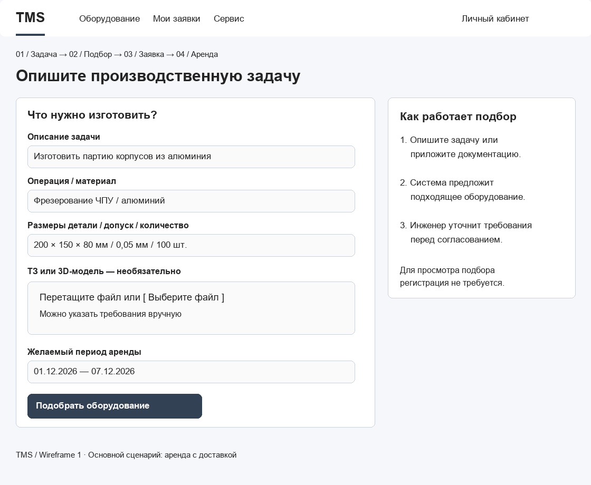
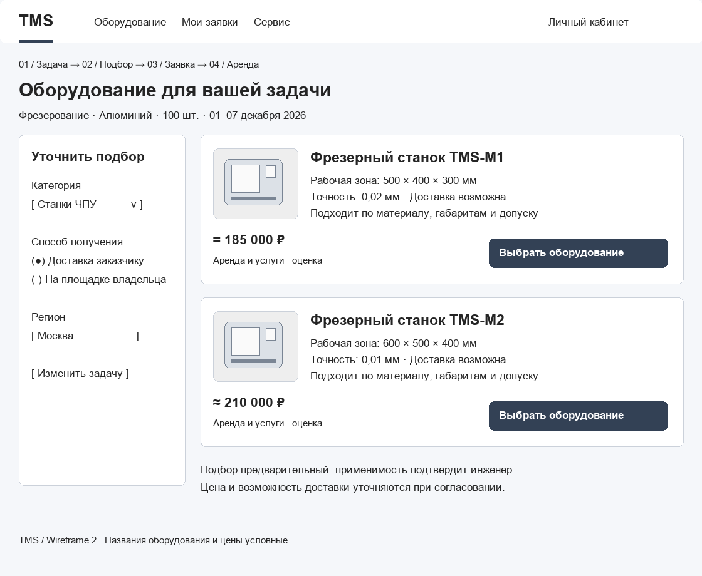
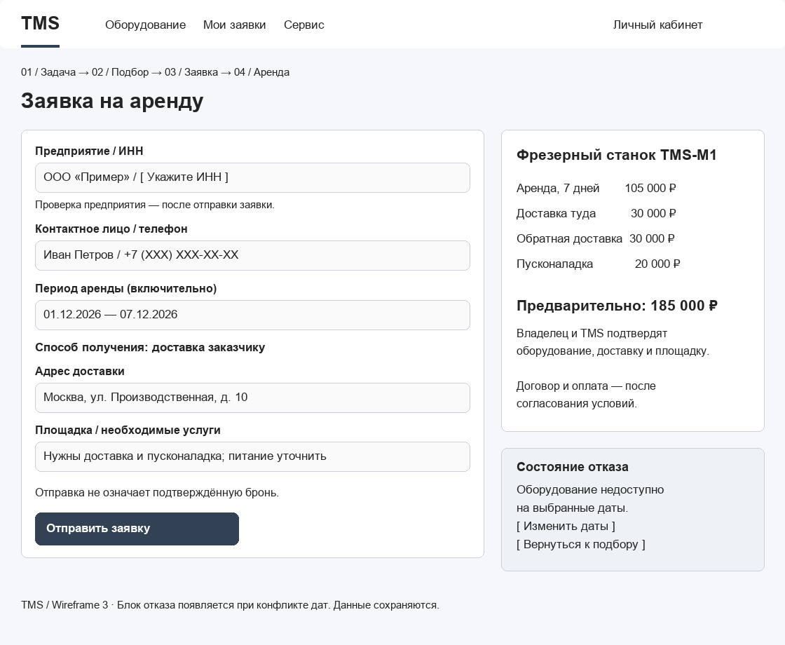
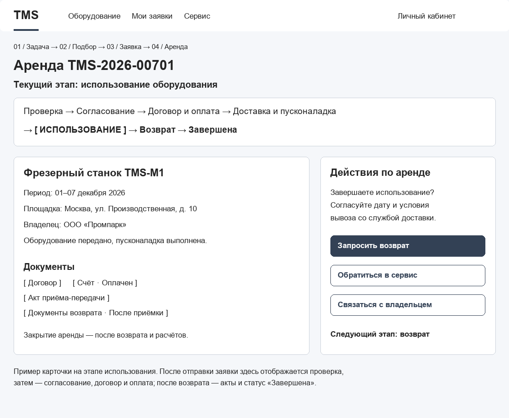

# ДЗ №4. DDD / BDD / Wireframes / API-First
[← ДЗ №1–3](README.md) | [ДЗ №4–5](README_FOR_HW4,5.md)

TMS — B2B-платформа аренды промышленного оборудования с доставкой, пусконаладкой и сервисным сопровождением. Альтернативный вариант — заказ изготовления деталей на оборудовании владельца.

В задании выделены доменные зоны приложения, описан критический путь MVP, представлены схемы основных экранов и JSON-контракты API.

## 1. DDD: доменные зоны и глоссарий

В TMS выделено шесть доменных зон. Арендатор и владелец разделены, поскольку у них разные задачи и сценарии работы.

### 1.1. Арендатор — Tenant

Поиск оборудования, отправка заявок и отслеживание аренды.

- **Tenant** — предприятие, арендующее оборудование.
- **TenantRepresentative** — сотрудник, действующий от имени арендатора.
- **RentalRequest** — заявка на аренду оборудования на выбранный период.
- **Rental** — согласованная аренда оборудования на условиях договора.
- **ManufacturingRequest** — заявка на изготовление деталей силами владельца вместо аренды оборудования.

### 1.2. Владелец оборудования — EquipmentOwner

Размещение предложений и согласование заказов. Владельцем может быть стороннее предприятие или сама TMS.

- **EquipmentOwner** — предприятие, сдающее оборудование или выполняющее заказы на нём.
- **RentalOffer** — предложение оборудования в аренду с указанием цены и условий.
- **AvailabilityCalendar** — календарь доступности оборудования.
- **Reservation** — подтверждённая бронь оборудования на согласованный период.
- **ManufacturingOrder** — принятый владельцем заказ на изготовление деталей на своём оборудовании.

### 1.3. Оборудование — Equipment

Каталог оборудования, его описание, поиск и фильтрация.

- **EquipmentUnit** — конкретная единица оборудования с уникальным идентификатором.
- **EquipmentCard** — карточка с описанием, фотографиями и сведениями о владельце.
- **EquipmentCategory** — категория: станки ЧПУ, средства контроля, аддитивное оборудование.
- **TechnicalSpecification** — технические характеристики: размеры рабочей зоны, точность, мощность и другие параметры.
- **EquipmentCondition** — техническое состояние и готовность к эксплуатации.

### 1.4. Сервис и доставка — ServiceAndDelivery

Перевозка, подготовка оборудования к работе, обслуживание и возврат.

- **Delivery** — доставка оборудования заказчику и обратно владельцу.
- **SiteReadinessCheck** — проверка готовности площадки к установке оборудования.
- **Commissioning** — монтаж, подключение и пусконаладка.
- **ServiceRequest** — заявка на техническое или метрологическое обслуживание.
- **EquipmentReturn** — возврат оборудования с проверкой состояния и комплектности.

### 1.5. Интеллектуальный подбор — IntelligentMatching

Анализ производственной задачи и подбор подходящего оборудования.

- **ProductionTask** — задача заказчика: что нужно изготовить, из какого материала и в каком количестве.
- **DesignFile** — загруженная 3D-модель или чертёж детали.
- **ProcessingRequirements** — требования к операциям, размерам и точности обработки.
- **EquipmentMatch** — рекомендованное оборудование с объяснением соответствия требованиям.
- **EquipmentPackage** — комплект оборудования для задачи, например станок и средства контроля.

### 1.6. Финансы и документы — FinanceAndDocuments

Оформление сделок, учёт оплаты и расчёты с владельцами.

- **Agreement** — договор аренды оборудования или изготовления деталей.
- **Invoice** — счёт на оплату с суммой и реквизитами.
- **Payment** — платёж за аренду, изготовление или сопутствующие услуги.
- **Act** — акт передачи оборудования, приёмки деталей или оказанных услуг.
- **OwnerSettlement** — расчёт с владельцем с учётом комиссии TMS.
  
## 2. BDD: критический путь MVP

Критический путь описывает последовательность действий, необходимых пользователю для получения результата; BDD-сценарии фиксируют ожидаемое поведение сервиса при успешном прохождении этого пути и при отказе.

**Критический путь:** арендатор описывает производственную задачу, прикладывает ТЗ или 3D-модель → получает результаты подбора → выбирает оборудование, период аренды и доставку → авторизуется и указывает данные предприятия → отправляет заявку → получает подтверждение регистрации → проходит проверку предприятия → согласует условия с владельцем и службой сервиса → подписывает договор и вносит предусмотренную оплату → получает оборудование с пусконаладкой → использует оборудование → возвращает его → получает закрывающие документы.

Загрузка 3D-модели необязательна: требования можно указать вручную или передать в ТЗ. Если данных недостаточно, их уточняет инженер TMS.

Для первого заказа проверяются ИНН, реквизиты предприятия и полномочия представителя. Проверка не мешает предварительному подбору, но необходима для перехода к согласованию сделки. Повторная проверка требуется при изменении данных.

### Сценарий 1. Успешная аренда оборудования с доставкой

**Дано:**
- у арендатора есть производственная задача и требования к оборудованию;
- на платформе есть подходящее оборудование, доступное на нужный период;
- владелец готов предоставить оборудование, а доставка и установка на площадке заказчика возможны.

**Когда:**
- арендатор передаёт требования и получает результаты подбора;
- выбирает оборудование, период аренды и адрес доставки;
- авторизуется, заполняет данные предприятия и отправляет заявку;
- TMS проверяет предприятие и полномочия представителя;
- владелец подтверждает доступность, а служба сервиса — возможность доставки и готовность площадки;
- стороны согласуют условия, подписывают договор, а арендатор вносит предусмотренную оплату;
- служба сервиса доставляет оборудование и выполняет пусконаладку;
- после использования арендатор передаёт оборудование для возврата, а владелец принимает его без замечаний.

**Тогда:**
- арендатор получает подходящее и готовое к работе оборудование на согласованный период;
- передача и возврат фиксируются актами;
- после возврата и завершения расчётов аренда получает статус «Завершена»;
- закрывающие документы доступны участникам в личных кабинетах.

### Сценарий 2. Выбранное оборудование стало недоступно

**Дано:**
- арендатор передал производственную задачу и получил результаты подбора;
- авторизовался, выбрал оборудование, указал период аренды и адрес доставки;
- до отправки заявки оборудование было забронировано другим заказчиком на пересекающийся период.

**Когда:**
- арендатор нажимает «Отправить заявку».

**Тогда:**
- заявка на недоступное оборудование не создаётся;
- появляется сообщение «Оборудование недоступно на выбранные даты. Измените период или выберите другой вариант»;
- производственная задача и введённые данные сохраняются;
- арендатор может изменить период или выбрать другое оборудование из результатов подбора.

## 3. Wireframes: ключевые экраны

Для критического пути MVP подготовлены четыре экрана со стороны арендатора: описание задачи, подбор оборудования, оформление заявки и сопровождение аренды. Схемы показывают расположение основных блоков и действия пользователя. Данные и цены приведены для примера.

### 3.1. Производственная задача

Арендатор описывает задачу, указывает материал, размеры, требования к точности и желаемый период аренды. При необходимости прикладывает ТЗ или 3D-модель. Загрузка файла необязательна: требования можно заполнить вручную.

Кнопка «Подобрать оборудование» переводит пользователя к результатам подбора.



### 3.2. Подбор оборудования

На экране представлены подходящие варианты с характеристиками, объяснением соответствия задаче и предварительной стоимостью. Арендатор может уточнить параметры поиска, выбрать доставку или использование на площадке владельца.

Кнопка «Выбрать оборудование» открывает форму заявки. Применимость оборудования и окончательные условия подтверждаются при согласовании.



### 3.3. Оформление заявки

Арендатор указывает предприятие, ИНН, контактные данные, период аренды и адрес доставки. Рядом отображается предварительный расчёт стоимости оборудования и услуг. Проверка предприятия проводится после отправки заявки, до согласования сделки.

Кнопка «Отправить заявку» регистрирует обращение и открывает карточку аренды. Отправка заявки ещё не означает подтверждение брони.

На схеме также показано состояние отказа из BDD: если оборудование стало недоступно, пользователь видит сообщение и может изменить даты или вернуться к подбору. Введённые данные сохраняются.



### 3.4. Карточка аренды

Карточка сопровождает пользователя от регистрации заявки до завершения аренды. В ней отображаются текущий этап, оборудование, условия, документы и доступные действия.

Последовательность этапов:

**Проверка → Согласование → Договор и оплата → Доставка и пусконаладка → Использование → Возврат → Завершена**

На схеме показан этап использования: арендатор может обратиться в сервис, связаться с владельцем или запросить возврат. На предыдущих этапах здесь доступны согласование условий, договор и оплата. После возврата и завершения расчётов появляются закрывающие документы.




## 4. API-First: контракты запросов и ответов

Контракты определяют данные, которыми обмениваются интерфейс и сервер. Ниже указаны названия полей и их типы.

### Получение карточки оборудования

**GET /api/v1/equipment/{id}**

Ответ — **200 OK**:

```text
{
  "id": String,
  "name": String,
  "description": String,
  "owner_name": String,
  "daily_price": Integer,
  "delivery_possible": Boolean
}
```

### Отправка заявки на аренду

**POST /api/v1/rental-requests**

Запрос:

```text
{
  "equipment_id": String,
  "company_name": String,
  "inn": String,
  "contact_phone": String,
  "start_date": Date,
  "end_date": Date,
  "delivery_address": String
}
```

Ответ — **201 Created**:

```text
{
  "request_id": String,
  "status": String,
  "message": String
}
```

Отказ — **409 Conflict**, если оборудование недоступно:

```text
{
  "code": String,
  "message": String
}
```


# ДЗ №5. Архитектура TMS: C4

В данном задании представлена архитектура TMS на двух уровнях модели C4:

- **C1 — контекст:** пользователи платформы и внешние системы, с которыми она взаимодействует.
- **C2 — контейнеры:** основные приложения и хранилища данных внутри TMS, а также связи между ними.

Дополнительно приведён выбор ключевых технологий для MVP с кратким обоснованием.

## 1. C1 — контекст системы

Схема показывает TMS как единую систему: кто ей пользуется, какие задачи решает и с какими внешними сервисами обменивается данными.

**Условные обозначения:** синий блок — платформа TMS, зелёные блоки — внешние системы, значки пользователей — участники платформы. Стрелки показывают взаимодействие, подписи поясняют его назначение.
## 2. C2 — контейнеры

Схема раскрывает внутреннее устройство TMS: веб-интерфейсы пользователей, серверную часть и хранилища данных. Для каждого контейнера указаны его назначение, выбранные технологии и связи с другими частями платформы и внешними сервисами.

